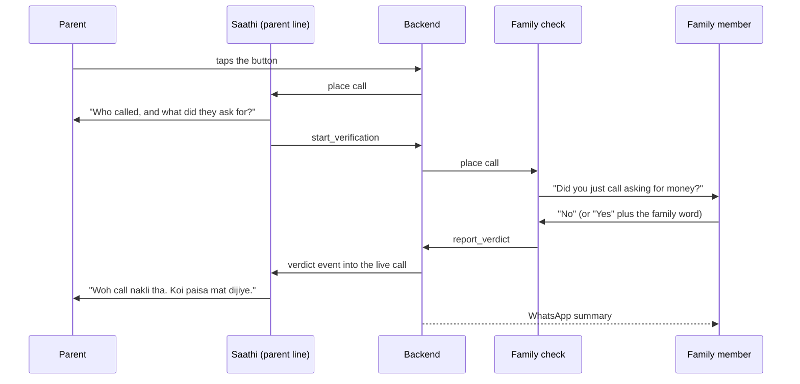

# Asli hai?

One tap before a parent pays. A voice agent calls the real family member, checks the family word, and tells the parent "safe, don't pay" while they wait on the line.

## The problem

Parents over 55 whose children live in another city get calls like "Papa, accident ho gaya, paise bhejo" or "CBI se bol raha hoon". The scam works in the two minutes between that call and the transfer. Asli hai? is built for those two minutes.

## How it works

Two Bolna graph agents and a small backend. The parent never hangs up.



1. The parent taps `tap.html`. The page asks them to hang up the other call, and 15 seconds later the backend calls them with Saathi, the parent-line agent.
2. Saathi finds out in two questions who called, what they asked for and how much.
3. For a family claim, Saathi calls `start_verification`. The backend calls the matching registered contact with the family-check agent while the parent waits.
4. The family member is asked one yes/no question. "No" settles it. "Yes" unlocks money, so it also needs the family word.
5. The backend decides the verdict and fires it into the parent's live call as a Bolna event. A static node plays it in about 50 ms.
6. Police, CBI, TRAI, courier or bank claims get a fixed message: there is no such thing as a "digital arrest", hang up, don't pay. If money already went, Saathi reads out 1930, the cybercrime helpline. Either way the backend rings the first family contact so someone calls the parent back, even if the parent hangs up early.
7. The family gets a WhatsApp summary of what happened.

## Safety by design

- **Fixed verdict wording.** Every line that must never vary is a static node, so the LLM never improvises a verdict.
- **The family word never reaches an LLM.** It isn't in any prompt or log line. Only `backend/verdict.py` compares it, in English letters or the family's own script, after lowercasing and stripping spaces and punctuation.
- **Three verdict rules:**
  - "No, I didn't call" → `child_safe`.
  - "Yes" plus the right family word → `child_confirmed`.
  - Anything else, every contact unreachable, or 75 seconds gone → `not_confirmed`, which tells the parent not to pay until they reach the family themselves.
- **No answer means the next contact.** Unanswered, busy or voicemail calls move on to the next registered contact.
- **One verdict per session.** Repeated tool calls are ignored. Webhooks are unsigned, so the backend re-reads each call's status from Bolna's API before acting on it.

## Accessibility

The people using this are parents over 55, often in a panic.

- **Every page in 12 languages, plus Hinglish.** The home page, signup and the tap button come in every call language, plus Hinglish (Hindi in English letters). English pages are entirely English. There's a language picker on each page. Translations live in `web/i18n/<language>.json`, and a page loads only the language in use.
- **Readable scripts.** Each script gets a matching Noto font, loaded only when that language is picked, so Tamil, Odia and the rest don't fall back to whatever the phone has.
- **The parent's own setting.** The tap button opens in the language the family picked at signup and remembers its own setting, so a child browsing the site in English doesn't change it for the parent.
- **A demo in any language.** The simulator plays the call in any of the 12 languages, with subtitles in the page's language.
- **One question at a time.** Signup walks through nine short steps, with a progress bar, big inputs, tappable language tiles and a review screen before anything is saved.
- **Larger text** with one button on every page.
- **One huge button.** The parent's only control is a single, high-contrast button with a short vibration when pressed.
- **Screen readers and keyboards.** Every form field has a label, errors are tied to their fields and focus moves to the first one, status changes are announced, and there's a skip link on every page.
- **Calm motion.** Animation is off when the device asks for reduced motion, and the simulator can be paused or stepped one line at a time.
- **Checked automatically.** axe-core reports no WCAG 2.2 AA violations on any page, in either language.

## Languages

Saathi speaks 12 languages: Hindi, English, Bengali, Marathi, Telugu, Tamil, Gujarati, Kannada, Malayalam, Punjabi, Odia and Assamese.

- **The language is chosen at signup.** Every call opens in it through `agent_language`, and Bolna's language switching follows the caller if they clearly move to another language mid-call.
- **One agent per role.** Each Sarvam agent carries a `multilingual_config` with a Sarvam transcriber and a female Sarvam voice per language.
- **Every fixed safety line comes in all 12 languages**, each with its own pre-rendered audio. So does the "calling your family now" message.
- **Greetings come from the backend.** They include the parent's and family member's names, so `backend/languages.py` builds them in the family's language for each call.
- **The comparison stack is Hindi-only.** Families in other languages always use the Sarvam stack.

The non-Hindi lines were written for this project and should be checked by a native speaker before real families rely on them.

## Voice stacks

The same graph runs on two stacks, so accuracy on Hindi names and seconds to verdict can be compared. Drills alternate between them, and every session records its `stack`.

| Stack | Listen | Speak | Think |
| --- | --- | --- | --- |
| `sarvam` (default) | Sarvam `saaras:v4` | Sarvam `bulbul:v4-flash` | `gpt-5.4-mini` |
| `compare` | Deepgram `nova-3` | Cartesia `sonic-3.6` | `gpt-5.4-mini` |

## Layout

| Path | What |
| --- | --- |
| `agents/` | The four Bolna graph agents: parent line and family check, one of each per stack |
| `backend/` | FastAPI and SQLite. Places the calls, decides the verdict, fires it into the live call, sends the summary |
| `web/` | `index.html` is the home page with a check simulator; `signup.html` registers a family through a one-question-per-screen questionnaire; `tap.html` is the parent's one-tap button (`?demo=1` shows it without placing a call) |
| `scripts/` | `push_agents.py` creates or updates the agents, `summary_workflow.py` builds the WhatsApp workflow, `new_session.py` runs a timed test session |

### Backend endpoints

| Endpoint | Called by | Does |
| --- | --- | --- |
| `POST /families` | Signup page | Registers a parent, 1–2 contacts and the family word |
| `POST /trigger` | Tap page | Starts a session and calls the parent |
| `POST /tools/start_verification` | Parent agent | Calls the family member and starts the 75-second timer |
| `POST /tools/report_verdict` | Family-check agent | Applies the verdict rules and fires the event |
| `POST /webhooks/bolna` | Bolna | Moves to the next contact on no answer; sends the summary when the call ends |
| `GET /lookup` | Bolna inbound | Identifies a parent calling in, once there is an inbound number |

## Run locally

```bash
pip install -r requirements.txt
cp .env.example .env    # fill BOLNA_API_KEY, TOOL_SECRET, PUBLIC_BASE_URL
python -m uvicorn backend.app:app --port 8000
```

`TOOL_SECRET` is any long random string. The agents send it with every tool call, so only they can reach the tool endpoints. Bolna must reach the backend over HTTPS, so put the backend behind a tunnel or host it, and set `PUBLIC_BASE_URL` to that address.

- Register a family at `/web/signup.html`. The page returns the parent's `tap.html?f=...` link.
- Open that link on the parent's phone and add it to the home screen.

## Deploy on Render

`render.yaml` is a Render Blueprint: a Starter web service in Singapore with a 1 GB disk for the SQLite database.

1. In Render, choose **New → Blueprint** and pick this repo.
2. Fill in the secret variables from your `.env`: `BOLNA_API_KEY`, `TOOL_SECRET`, the four `AGENT_ID_*` ids, and a `SIGNUP_CODE` so strangers can't register numbers.
3. Once the service is live, put its URL in `PUBLIC_BASE_URL` and run `python scripts/push_agents.py` to point the agents at it.

## Agents

```bash
python scripts/push_agents.py    # creates the agents, or updates them when AGENT_ID_* is already in .env
```

The JSON in `agents/` keeps `https://YOUR-BACKEND` and `YOUR_TOOL_SECRET` as placeholders. They are filled in at push time, so no secret is ever stored in the repo. Re-run the script whenever `agents/*.json` or `PUBLIC_BASE_URL` changes.

## Family summary

After each session the backend sends a short WhatsApp summary to every family contact. It runs a published Bolna workflow whose `aisensy_whatsapp` node sends an approved AiSensy template.

1. In AiSensy, submit the template body from `python scripts/summary_workflow.py --template-text` as a Utility template (language `en`). Launch it as an API campaign once it's approved.
2. In Bolna, link the AiSensy project under Integrations.
3. Put the template and campaign names in `.env` as `AISENSY_TEMPLATE_NAME` and `AISENSY_CAMPAIGN_NAME`.
4. `python scripts/summary_workflow.py --publish` creates the workflow and prints the `SUMMARY_WORKFLOW_ID` for `.env`.

Sending runs in the background, so a slow provider never delays the verdict. Each message carries a `reference_id` of `<session>-<priority>`, so a contact can't be messaged twice for the same session.

## Measuring

```bash
python scripts/new_session.py <family_id> --expect child_safe    # places a real call; shows the numbers and asks first
```

Each run is appended to `test_runs.csv` with the outcome, the seconds from tap to verdict, and the current passing streak.
